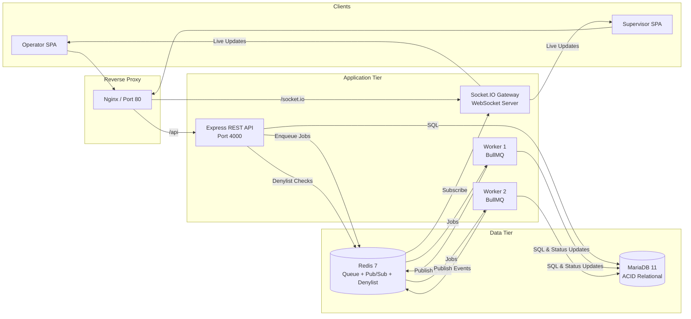

# Real-Time Service Request Management System (SRMS)

[](https://github.com/HMZiyad/technoheaven_SRMS/actions/workflows/ci.yml)

A production-grade, full-stack **Real-Time Service Request Management System** designed for high concurrency, non-blocking asynchronous processing, live WebSocket updates, role-based access control, and complete audit logging.

---

## Pre-Implementation Planning & Design Documentation

The foundational architecture, security specifications, and project roadmap established prior to implementation:
- **[Project Planning](docs/project_planning.md)** — Core business requirements, system capabilities, technology justifications, and phased task roadmap.
-  **[System Architecture](docs/system_architecture.md)** — End-to-end component topology, data flows, state machine lifecycle, and non-blocking worker pipeline design.
-  **[Security Planning](docs/security_planning.md)** — Threat modeling (STRIDE), cryptographic token revocation, RBAC policies, and defense-in-depth controls.
- **[System Analysis](docs/01-system-analysis.md)** & **[System Design](docs/02-system-design.md)** — Architectural decisions, entity relationships, and protocol specifications.

---

## 1. System Architecture



### Architecture Highlights
- **Decoupled Asynchronous Processing:** The API server handles request ingestion, validation, and enqueueing in milliseconds without blocking. Long-running simulated service computations (5–30 seconds) execute inside independent worker pool containers.
- **Priority Queueing:** BullMQ maps request priorities (`URGENT = 1`, `HIGH = 2`, `MEDIUM = 3`, `LOW = 4`), allowing emergency requests to jump ahead of routine requests.
- **Room-Based WebSocket Gateway:** Socket.IO dispatches domain events via Redis Pub/Sub directly to authenticated client rooms (`role:supervisor`, `user:<id>`, `request:<id>`), ensuring strict audience isolation.
- **Optimistic Concurrency Control:** Every update utilizes an atomic `WHERE version = ?` check to prevent concurrent supervisors from overwriting state.
- **Cooperative Cancellation:** Workers poll `cancel_requested` between stages (`Validate` -> `Allocate` -> `Process` -> `Finalize`) to cleanly halt execution without corrupting records.

---

## 2. Technology Stack & Justification

| Layer | Technology | Justification |
|---|---|---|
| **Backend Framework** | Node.js 20, Express, TypeScript | Type safety across domains, mature WebSocket ecosystem, high I/O throughput |
| **Database & ORM** | MariaDB 11, Prisma ORM | Relational ACID transactions, foreign key constraints, full-text search, schema migrations |
| **Job Queue & Cache** | Redis 7, BullMQ | Fast persistent queues, concurrency throttling, exponential retry backoff, pub/sub event bus |
| **Real-Time Gateway** | Socket.IO | Auto-reconnect, fallback transports, room management, low latency |
| **Frontend Framework** | React 18, Vite, TypeScript | Modern component architecture, fast build cycles, typed state management |
| **Client State & UI** | Zustand, TanStack Query, Tailwind CSS | Reactive socket store, optimistic updates, responsive accessible UI |
| **DevOps & Containers**| Docker Compose, Nginx, GitHub Actions | Identical multi-container environment across dev, CI, and production |

---

## 3. Quick Start (One Command)

### Prerequisites
- Docker Engine & Docker Compose (`docker compose version`)
- Git

### 1. Clone & Configure
```bash
git clone https://github.com/HMZiyad/technoheaven_SRMS.git
cd technoheaven_SRMS
cp .env.example .env
```

### 2. Start the Complete Stack
```bash
docker compose up -d --build
```

### 3. Run Database Migrations & Seed Data
```bash
docker compose run --rm migrate
docker compose exec api npx tsx src/db/seed.ts
```

### 4. Access the Application
- **Frontend Web Application:** [http://localhost:5173](http://localhost:5173)
- **Backend REST API:** [http://localhost:4000/api/v1/health/live](http://localhost:4000/api/v1/health/live)

---

## 4. Pre-seeded Demo Accounts

All seeded accounts use password: `Password123!`

| Role | Email | Password | Permissions & Views |
|---|---|---|---|
| **Supervisor** | `supervisor@srms.local` | `Password123!` | Live monitoring dashboard, view all requests, assign, change priority, cancel, retry failed |
| **Operator 1** | `operator1@srms.local` | `Password123!` | Create requests (with Idempotency-Key), view own requests, cancel own, add comments |
| **Operator 2** | `operator2@srms.local` | `Password123!` | Secondary operator account for testing role isolation and multi-user concurrency |
| **Admin** | `admin@srms.local` | `Password123!` | System metrics, user and role administration, full supervisor capabilities |

> **Tip:** The Login Page includes one-click quick-fill buttons for all test accounts.

---

## 5. REST API Documentation

Base URL: `/api/v1`

### Authentication (`/api/v1/auth`)
| Method | Endpoint | Access | Description |
|---|---|---|---|
| `POST` | `/auth/register` | Public | Register a new operator account (rate limited) |
| `POST` | `/auth/login` | Public | Authenticate user, returns JWT access token (strict rate limit) |
| `GET` | `/auth/me` | Authenticated | Return currently logged-in user profile |
| `POST` | `/auth/logout` | Authenticated | Revoke JWT token by adding `jti` to Redis denylist |

### Service Requests (`/api/v1/requests`)
| Method | Endpoint | Access | Description |
|---|---|---|---|
| `POST` | `/requests` | Operator+ | Create service request (supports `Idempotency-Key` header) |
| `GET` | `/requests` | Authenticated | List requests with pagination, status/priority/category filters, search `q` |
| `GET` | `/requests/:id` | Owner/Supervisor | Fetch request details with relation metadata |
| `PATCH` | `/requests/:id` | Supervisor/Admin | Update priority, assignee, details (requires `version` for optimistic lock) |
| `POST` | `/requests/:id/cancel` | Owner/Supervisor | Cancel request (instant if QUEUED; cooperative if IN_PROGRESS) |
| `POST` | `/requests/:id/retry` | Supervisor/Admin | Retry a FAILED request, resets attempts and re-enqueues |
| `GET` | `/requests/:id/history` | Owner/Supervisor | Fetch immutable status audit history timeline |

### Comments & Stats
| Method | Endpoint | Access | Description |
|---|---|---|---|
| `POST` | `/requests/:id/comments` | Owner/Supervisor | Add comment to request, broadcasts to viewers |
| `GET` | `/requests/:id/comments` | Owner/Supervisor | Fetch comment thread for request |
| `GET` | `/stats` | Supervisor/Admin | Live counts by status, priority, and average processing time |
| `GET` | `/events?since=<id>` | Authenticated | Reconnect catch-up sync for missed real-time events |

---

## 6. Real-Time WebSocket Events Catalog

Clients connect to Socket.IO with their JWT token in `auth: { token }`.

| Event Name | Audience | Payload Summary | Trigger Condition |
|---|---|---|---|
| `request:created` | Supervisors + Owner | `{ id, reference, title, priority, status }` | New service request enqueued |
| `request:status_changed` | Supervisors + Owner | `{ id, from, to, changedById, at }` | Status transition (e.g. QUEUED -> IN_PROGRESS) |
| `request:progress` | Supervisors + Owner | `{ id, progress, stage }` | Worker reports stage milestone (throttled to 1/s) |
| `request:updated` | Supervisors + Owner | Full updated request object | Priority, assignee, or cancelRequested changed |
| `request:comment_added` | Supervisors + Owner | `{ id, requestId, author, body, createdAt }`| New comment posted to request |
| `stats:updated` | Supervisors only | Snapshot of status counts and metrics | Throttled background system metrics change |

---

## 7. Concurrency Model & Live Demonstration

### How to Demo Horizontal Scaling:
Scale the worker pool to 3 containers dynamically:
```bash
docker compose up -d --scale worker=3
```

### Run Automated Load Test:
Execute the concurrency simulation script to fire 30 prioritized requests:
```bash
docker compose exec api npx tsx scripts/load-test.ts
```

### Observe Concurrency:
1. Open **Supervisor Dashboard** in one window (`supervisor@srms.local`).
2. Open **Operator Dashboard** in another window (`operator1@srms.local`).
3. Submit multiple requests in quick succession with varying priorities.
4. **URGENT** requests will jump the queue and begin processing ahead of **LOW** priority requests.
5. Multiple requests will progress through `Validate` -> `Allocate` -> `Process` -> `Finalize` stages simultaneously across the worker pool without blocking the API.

---

## 8. Security & Defense-in-Depth

- **Password Security:** Argon2id hashing with unique cryptographic salt and timing attack equalization (`dummyHash`).
- **Token Invalidation:** Stateless HS256 JWTs paired with an in-memory Redis token revocation denylist.
- **Input Validation:** Strict Zod schemas on all routes, rejecting unknown properties to prevent mass assignment vulnerabilities.
- **Rate Limiting:** Sliding-window Redis counters on sensitive auth and API ingestion endpoints.
- **Role-Based Access Control:** Middleware verification coupled with service-level object ownership checks.
- **IDOR Protection:** Operators are strictly forbidden from viewing, subscribing to, or modifying requests created by other operators.
- **Security Headers:** Comprehensive Helmet protection, CORS whitelist, request body size limits, and non-root container users.

---

## 9. Project Directory Tree

```
technoheaven_SRMS/
├── docker-compose.yml              # Dev environment (MariaDB, Redis, API, Worker, Frontend)
├── docker-compose.prod.yml         # Production multi-replica deployment with Nginx
├── Makefile                        # Convenient development shortcuts
├── .env.example                    # Environment configuration template
├── docs/                           # Planning, architecture & security specifications
│   ├── project_planning.md         # Initial project planning & requirements
│   ├── system_architecture.md      # System architecture & pipeline design
│   ├── security_planning.md        # Security planning & threat model
│   ├── 01-system-analysis.md       # Requirements analysis
│   ├── 02-system-design.md         # System design specifications
│   ├── tasks.md                    # Detailed task breakdown
│   └── adr/                        # Architecture Decision Records
├── backend/
│   ├── Dockerfile                  # Multi-stage container build (base, dev, build, prod)
│   ├── prisma/
│   │   └── schema.prisma           # Prisma schema for MariaDB
│   ├── scripts/
│   │   └── load-test.ts            # Concurrency verification script
│   ├── src/
│   │   ├── app.ts                  # Express application factory
│   │   ├── server.ts               # HTTP & Socket.IO server bootstrap
│   │   ├── worker.ts               # BullMQ worker process entrypoint
│   │   ├── controllers/            # HTTP endpoint routers
│   │   ├── domain/                 # State machine, policies, transitions
│   │   ├── middleware/             # Auth, RBAC, Rate limiter, Request ID, Error handler
│   │   ├── queue/                  # BullMQ producer, pipeline, reconciler
│   │   ├── realtime/               # Socket.IO gateway, event publisher, room manager
│   │   ├── repositories/           # Prisma data access layer
│   │   └── services/               # Core business logic
│   └── tests/                      # Unit and integration test suites
└── frontend/
    ├── Dockerfile                  # Multi-stage React/Nginx container build
    ├── src/
    │   ├── App.tsx                 # Routing and real-time socket bridge
    │   ├── api/                    # Typed HTTP client wrapper
    │   ├── components/             # Reusable UI widgets, badges, navigation
    │   ├── hooks/                  # useSocket and query hooks
    │   ├── pages/                  # Login, Operator, Supervisor, Detail views
    │   └── store/                  # Zustand auth and live request stores
```

---

## 10. Verification & Tests

Run all unit and integration tests inside the test container:
```bash
docker compose exec api npm test
```
To run linting:
```bash
docker compose exec api npm run lint
```
