# System Architecture: Real-Time Service Request Management System

An in-depth architecture document. It expands sections 7 to 13 of `PLANNING.md` and is meant to become `docs/02-system-design.md`.

**Contents**

1. Architectural goals and drivers
2. System context
3. Container view (deployable units)
4. Component view (inside each container)
5. Data architecture
6. Request lifecycle and state machine
7. Key runtime flows (sequence diagrams)
8. Real-time communication architecture
9. Concurrency and background processing architecture
10. Consistency, idempotency, and failure handling
11. API architecture
12. Security architecture
13. Frontend architecture
14. Deployment architecture
15. Scalability strategy
16. Observability
17. Configuration management
18. Testing architecture
19. Architecture decision records (ADRs)
20. Known limitations and future evolution

---

## 1. Architectural goals and drivers

| # | Driver | Consequence for the design |
|---|---|---|
| D1 | Updates must reach clients without polling | WebSocket gateway plus an event bus from workers to gateway |
| D2 | Long-running work must never block the API | API only enqueues; separate worker process executes |
| D3 | Many requests processed simultaneously | Queue with configurable concurrency; horizontally scalable workers |
| D4 | No lost or double-processed work | Persistent queue, DB as source of truth, job locks, idempotent stages |
| D5 | Supervisors need full visibility, operators only their own | Room-based event routing and RBAC at API and socket levels |
| D6 | Easy to reason about and extend | Strict layering, explicit state machine, typed contracts |
| D7 | Reviewer can run it in minutes | Docker Compose, seeded demo data, one-command start |

**Architectural style:** a modular monolith for the API and gateway, plus a separate worker process, connected by a message queue and a pub/sub bus. This is intentionally *not* microservices: the domain is small, and the split follows the one boundary that matters, which is request/response work vs. long-running work.

---

## 2. System context

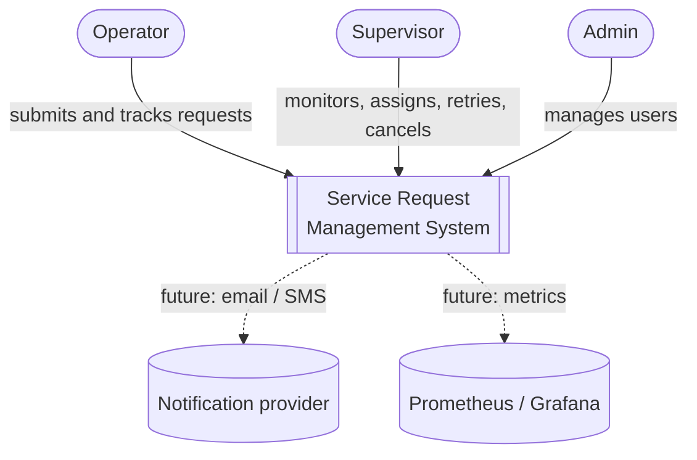

External systems in the current scope: none required. Dotted lines show planned extension points.

---

## 3. Container view (deployable units)

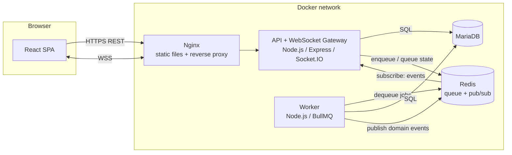

| Container | Responsibility | State | Scales by |
|---|---|---|---|
| **Nginx** | Serve built frontend, proxy `/api` and `/socket.io`, upgrade headers for WebSocket | Stateless | Replicas |
| **API + Gateway** | REST endpoints, auth, validation, enqueue jobs, hold WebSocket connections, forward events | Stateless (sessions are JWT; socket rooms rebuilt on reconnect) | Replicas behind a load balancer (Socket.IO Redis adapter) |
| **Worker** | Execute jobs concurrently, update DB, publish events | Stateless (job state in Redis and DB) | More worker containers and higher concurrency |
| **Redis** | BullMQ job queue, pub/sub event bus, Socket.IO adapter, rate-limit counters | Persistent (AOF enabled) | Single node for this scope; managed Redis in production |
| **MariaDB** | System of record | Persistent volume | Vertical scaling; read replicas later |

**Why the API and the gateway share a process:** they share authentication, and the gateway needs the same domain types. If WebSocket load grows, the gateway can be split out later without changing contracts, because it only consumes events from Redis.

---

## 4. Component view

### 4.1 API and gateway process

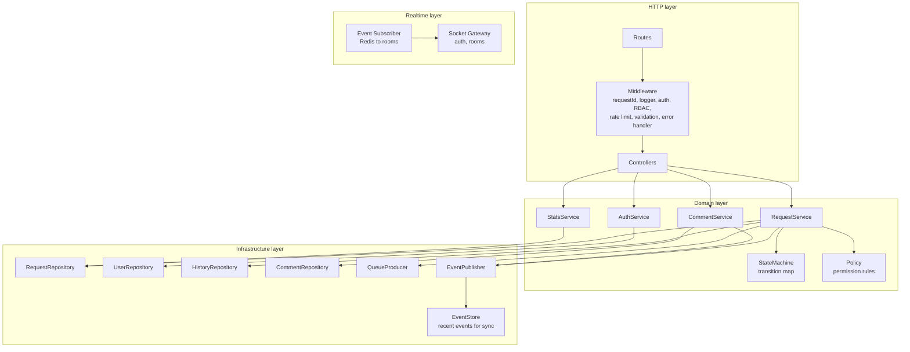

**Dependency rule:** arrows only point downward. Controllers never touch repositories; repositories never know about HTTP; the domain layer does not import Express or Socket.IO.

### 4.2 Worker process

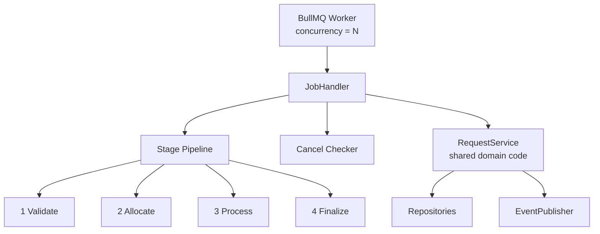

The worker reuses the **same domain services and state machine** as the API (shared package or shared source folder), so a status change means the same thing no matter who triggers it.

### 4.3 Responsibilities by layer

| Layer | Allowed to | Must not |
|---|---|---|
| Controller | Parse input, call one service method, map result to HTTP | Contain business rules, call the DB |
| Service | Enforce rules, orchestrate repositories, queue, events, wrap transactions | Know about HTTP or sockets |
| StateMachine | Say whether a transition is legal | Perform I/O |
| Repository | Run queries, map rows to domain objects | Enforce business rules |
| EventPublisher | Persist event to EventStore, publish to Redis | Decide who receives it |
| Socket Gateway | Authenticate sockets, manage rooms, emit events | Query the DB for business data |

---

## 5. Data architecture

### 5.1 Entities

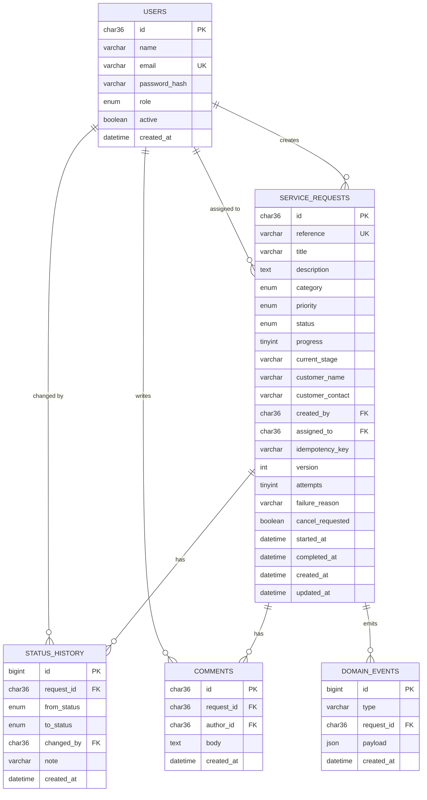

### 5.2 Design decisions

- **`reference`** is a human-friendly ID (`SR-000123`) generated from an auto-increment sequence; the UUID stays the internal key.
- **`version`** supports optimistic locking: every update is `UPDATE ... SET ..., version = version + 1 WHERE id = ? AND version = ?`. Zero rows affected means conflict (`409`).
- **`cancel_requested`** is the cooperative-cancel flag the worker polls between stages. It is separate from `status` so the API can request cancel without racing the worker.
- **`idempotency_key`** is unique per creating user (composite unique index `(created_by, idempotency_key)`).
- **`STATUS_HISTORY`** is append-only. Every status change writes one row inside the same transaction as the status update.
- **`DOMAIN_EVENTS`** is a short-retention table (for example 24 hours) used by the reconnect `sync` feature. It is *not* the source of truth for request state.
- **Progress writes are throttled:** progress (0 to 100) is written to the DB at stage boundaries only, while finer-grained progress goes through events and Redis.

### 5.3 Indexing strategy

| Index | Serves |
|---|---|
| `(status, priority, created_at)` | Dashboard lists, queue-like views |
| `(created_by, created_at)` | "My requests" |
| `(assigned_to, status)` | Assigned work view |
| `reference` unique | Lookup by human ID |
| `(created_by, idempotency_key)` unique | Duplicate-submit protection |
| FULLTEXT `(title, description)` | Search box |
| `(request_id, created_at)` on history/comments | Detail page |
| `(id)` on domain_events, plus `created_at` | Sync queries and cleanup |

### 5.4 Transactions

Operations that must be atomic (one DB transaction):

1. **Create:** insert request + insert first history row.
2. **Transition:** update request (with version check) + insert history row.
3. **Cancel:** set `cancel_requested` / status + history row.

Events are published **after** the transaction commits, never inside it (see 10.1).

---

## 6. Request lifecycle and state machine

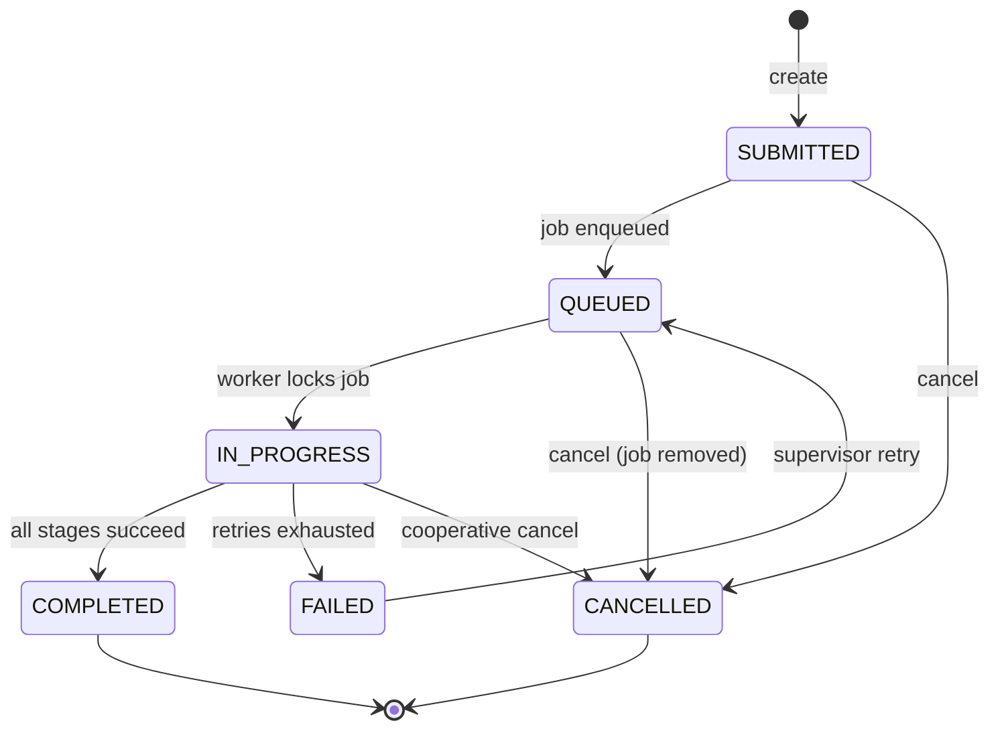

**Transition map (single source of truth in code):**

| From | Allowed to | Who may trigger |
|---|---|---|
| SUBMITTED | QUEUED, CANCELLED | system, owner/supervisor |
| QUEUED | IN_PROGRESS, CANCELLED | worker, owner/supervisor |
| IN_PROGRESS | COMPLETED, FAILED, CANCELLED | worker, owner/supervisor |
| FAILED | QUEUED | supervisor |
| COMPLETED, CANCELLED | none (terminal) | none |

Any other transition raises `InvalidTransitionError`, mapped to HTTP `409`.

**Processing stages** (progress ranges are illustrative):

| Stage | Progress | Simulated work |
|---|---|---|
| Validate | 0 to 15 | Check data, short delay |
| Allocate | 15 to 40 | Reserve "resources", medium delay |
| Process | 40 to 90 | Longest step, emits fine-grained progress |
| Finalize | 90 to 100 | Write result, close out |

A configurable failure probability (for example 10%) in the *Process* stage demonstrates retry and failure paths.

---

## 7. Key runtime flows

### 7.1 Create a request

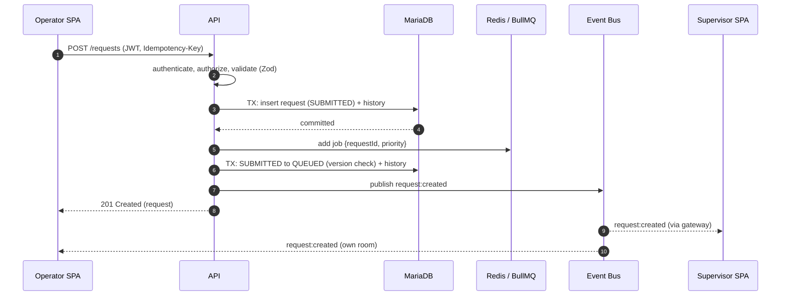

The response is returned right after enqueueing; nothing slow runs in this path.

### 7.2 Background processing with live progress

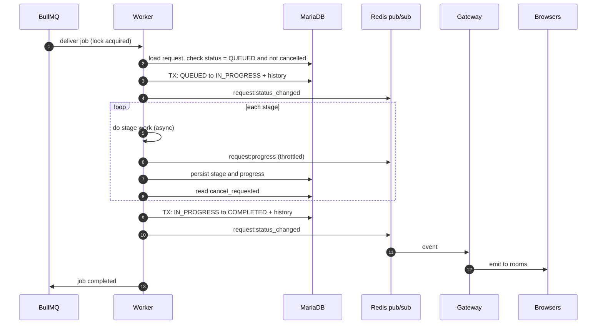

### 7.3 Cancel while processing

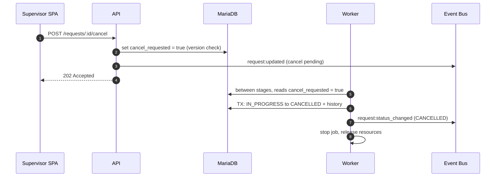

For `SUBMITTED` / `QUEUED` requests, the API cancels directly: it removes the job from the queue and sets `CANCELLED` in one service call, returning `200`.

### 7.4 Failure, retry, and supervisor retry

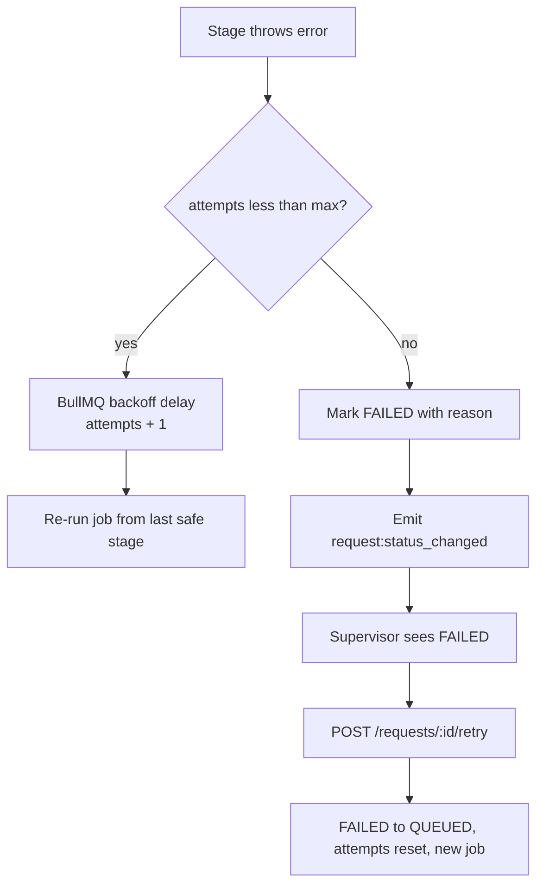

### 7.5 Client reconnect and sync

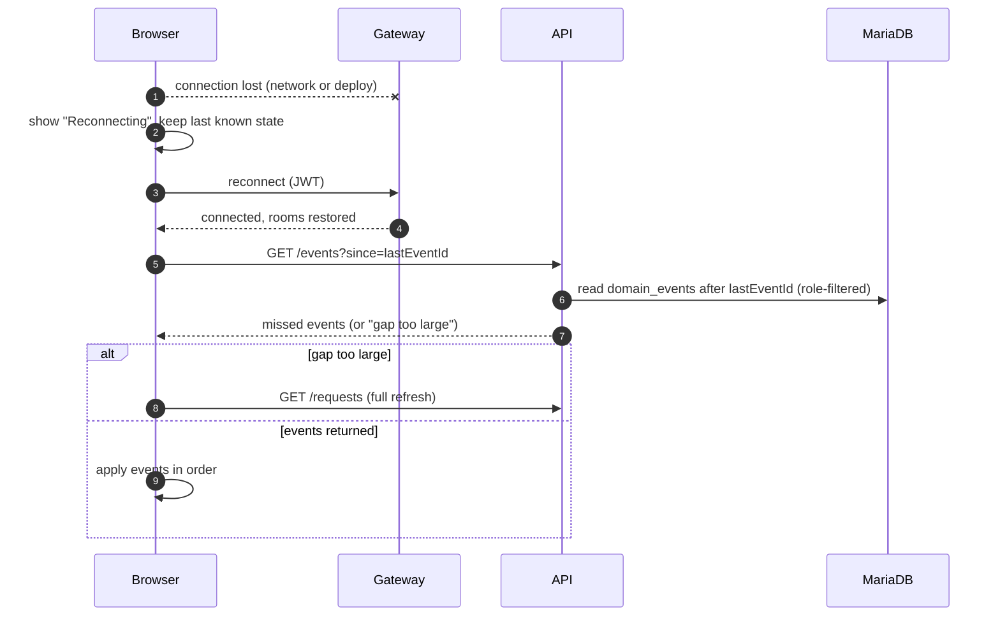

Every pushed event carries a monotonically increasing `eventId`. The client remembers the last one it applied.

---

## 8. Real-time communication architecture

### 8.1 Event pipeline

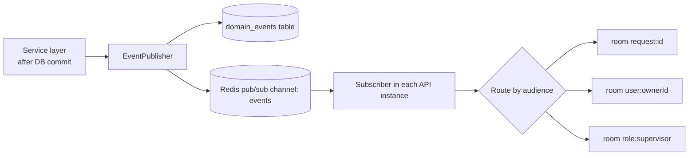

- **One channel, one envelope.** All events use the same envelope so routing is generic:

```json
{
  "eventId": 18452,
  "type": "request:status_changed",
  "requestId": "6f1c...",
  "ownerId": "a31b...",
  "assigneeId": null,
  "occurredAt": "2026-11-18T09:30:12.431Z",
  "data": { "from": "QUEUED", "to": "IN_PROGRESS" }
}
```

- **Routing rules:**
  - `role:supervisor` room receives every request event.
  - `user:<ownerId>` receives events for requests that user created.
  - `user:<assigneeId>` receives events for requests assigned to them.
  - `request:<id>` receives detail-level events (progress, comments) for users who opened that page.

### 8.2 Authentication and authorization on sockets

1. Client connects with `auth: { token }` (JWT).
2. Gateway middleware verifies the token; failure closes the connection.
3. Gateway joins the socket to `user:<id>` and, if supervisor/admin, `role:supervisor`.
4. `request:subscribe` is authorized by the same policy used in REST (owner, assignee, or supervisor).
5. Tokens expiring mid-session cause the server to disconnect; the client refreshes and reconnects.

### 8.3 Event catalog

| Event | Direction | Payload `data` | Audience |
|---|---|---|---|
| `request:created` | S to C | request summary | supervisors, owner |
| `request:status_changed` | S to C | `{from, to, reason?}` | supervisors, owner, assignee, request room |
| `request:progress` | S to C | `{progress, stage}` | request room, supervisors (throttled) |
| `request:updated` | S to C | changed fields | supervisors, owner, assignee |
| `request:comment_added` | S to C | comment | request room |
| `stats:updated` | S to C | stats snapshot | supervisors |
| `request:subscribe` | C to S | `{requestId}` | n/a |
| `request:unsubscribe` | C to S | `{requestId}` | n/a |

### 8.4 Efficiency measures

| Concern | Technique |
|---|---|
| Progress flood | Worker emits at most 1 progress event per request per second |
| Stats flood | Debounce `stats:updated` to once every 1 to 2 seconds, computed from cached counters |
| Payload size | List-level events send summaries; detail room gets full objects |
| Backpressure | Per-socket rate limit on client-to-server events |
| Multi-instance fan-out | Socket.IO Redis adapter plus the events channel |

### 8.5 Transport

WebSocket is the primary transport. Socket.IO's HTTP long-polling fallback is allowed **only as a transport fallback** for restricted networks; it is not an application-level polling loop, so the "no polling as primary mechanism" rule is still met. Configure `transports: ['websocket']` first and document this choice.

---

## 9. Concurrency and background processing architecture

### 9.1 Layers of concurrency

| Level | Mechanism | Purpose |
|---|---|---|
| API process | Node event loop, non-blocking I/O | Handle many HTTP and socket connections |
| Worker process | BullMQ `concurrency = N` (async jobs interleaved on the event loop) | Process N requests simultaneously |
| Horizontal | Multiple worker containers consuming the same queue | Scale throughput |
| CPU-bound work (if introduced) | `worker_threads` pool | Avoid blocking the event loop |

Simulated stages use `await sleep(...)` and I/O, so they are naturally cooperative. If real CPU-heavy work were added, it would move into a `worker_threads` pool.

### 9.2 Job model

```json
{
  "name": "process-request",
  "data": { "requestId": "6f1c...", "attempt": 1 },
  "opts": {
    "jobId": "req-6f1c...",
    "priority": 1,
    "attempts": 3,
    "backoff": { "type": "exponential", "delay": 2000 },
    "removeOnComplete": { "age": 3600 },
    "removeOnFail": false
  }
}
```

- **`jobId` equals the request ID**, so enqueueing twice cannot create two jobs for the same request.
- **Priority mapping:** URGENT = 1, HIGH = 2, MEDIUM = 3, LOW = 4 (lower number runs first).

### 9.3 Preventing double processing

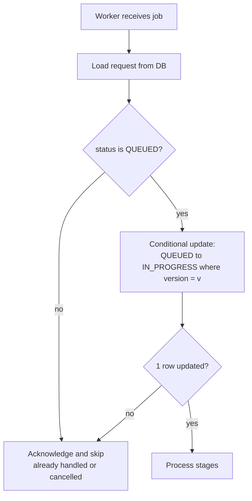

Two guards stack: BullMQ's lock gives each job to one worker at a time, and the conditional DB update makes the status change itself a compare-and-set.

### 9.4 Thread and race safety

| Shared resource | Risk | Guard |
|---|---|---|
| `service_requests` row | Lost update (supervisor edits while worker advances) | Optimistic locking with `version` |
| Job queue | Two workers take the same job | BullMQ lock plus status compare-and-set |
| In-memory progress throttle map | Cross-request interference | Keyed by request ID; no shared mutable state across jobs |
| Cancel flag | Worker misses cancel | Checked at every stage boundary and inside long stages every few seconds |
| Event ordering | Out-of-order delivery to UI | Monotonic `eventId`; UI ignores events older than the state it holds |

### 9.5 Stalled and orphaned jobs

- BullMQ's stalled-job checker returns jobs from crashed workers to the queue.
- A **reconciler** (scheduled job every minute) fixes rows stuck in `IN_PROGRESS` with no active job for longer than a timeout, either re-queueing them or marking them `FAILED` with reason `worker_lost`.
- A second reconciler re-enqueues `SUBMITTED` rows older than a threshold (covers the rare crash between DB commit and enqueue).

### 9.6 Graceful shutdown

On `SIGTERM`:

1. Worker stops accepting new jobs.
2. In-flight jobs get a grace period (for example 30 seconds) to finish or reach a safe checkpoint.
3. Unfinished jobs are released back to the queue.
4. API stops accepting new connections, drains requests, closes sockets with a `server_shutdown` reason so clients reconnect elsewhere.

---

## 10. Consistency, idempotency, and failure handling

### 10.1 Event publishing after commit

Publishing inside a DB transaction could announce changes that later roll back. The rule is: **commit first, then publish**. If publishing fails after commit, the change is still safe in the DB; clients heal through `sync` or a refetch. For stronger guarantees, a transactional **outbox** table can be added (listed under future evolution).

### 10.2 Idempotent create

- Client generates a UUID `Idempotency-Key` per form submission.
- Server stores it with the request. A repeat with the same key returns the original response (`200` with the existing request) instead of creating a duplicate.

### 10.3 Optimistic concurrency on edits

- Detail responses include `version`.
- `PATCH` must send `version`. If it changed, the server returns `409` with the current state, and the UI offers "reload and reapply".

### 10.4 Error model

```json
{
  "error": {
    "code": "INVALID_TRANSITION",
    "message": "Cannot move request from COMPLETED to QUEUED",
    "details": { "from": "COMPLETED", "to": "QUEUED" },
    "requestId": "c1a9..."
  }
}
```

| Error class | HTTP | Example code |
|---|---|---|
| Validation | 400 | `VALIDATION_FAILED` (with per-field details) |
| Authentication | 401 | `UNAUTHENTICATED` |
| Authorization | 403 | `FORBIDDEN` |
| Not found | 404 | `REQUEST_NOT_FOUND` |
| Conflict | 409 | `INVALID_TRANSITION`, `VERSION_CONFLICT` |
| Rate limit | 429 | `RATE_LIMITED` |
| Unexpected | 500 | `INTERNAL_ERROR` (no internal details leaked) |

A single error-handling middleware maps typed domain errors to responses and logs unexpected errors with the request ID.

### 10.5 Dependency failure behavior

| Failure | Behavior |
|---|---|
| Redis down at create | Request stays `SUBMITTED`; API returns `201` with a warning flag; reconciler enqueues when Redis returns |
| Redis down for events | Changes persist; clients heal on reconnect via `sync` |
| DB down | API returns `503`; `/health` reports not ready; workers pause |
| Worker crash | Job returns to queue; reconciler cleans stuck rows |
| API instance restart | Clients reconnect automatically and `sync` |

---

## 11. API architecture

- **Versioned base path:** `/api/v1`.
- **Resource-oriented URLs**, with action sub-resources for non-CRUD operations (`/cancel`, `/retry`).
- **Pagination:** `page` and `limit` (max 100), response includes `total`, `page`, `limit`. (Cursor pagination is a future option for very large tables.)
- **Filtering and search:** query params `status`, `priority`, `category`, `assignee`, `from`, `to`, `q`; multi-value allowed (`status=QUEUED,IN_PROGRESS`). `q` uses the fulltext index.
- **Sorting:** `sort=created_at:desc` from a whitelist of columns.
- **Contracts:** request/response shapes defined as Zod schemas and exported as TypeScript types; an OpenAPI document is generated from them and served at `/api/docs`.
- **Content negotiation:** JSON only.
- **Correlation:** every response carries `X-Request-Id`.

### Example: create request

```http
POST /api/v1/requests
Authorization: Bearer <jwt>
Idempotency-Key: 4d2e0c1a-...
Content-Type: application/json

{
  "title": "AC not cooling",
  "description": "Unit in room 4B stopped cooling since morning.",
  "category": "MAINTENANCE",
  "priority": "HIGH",
  "customerName": "Rahim Uddin",
  "customerContact": "+8801XXXXXXXXX"
}
```

```http
HTTP/1.1 201 Created
Location: /api/v1/requests/6f1c...

{
  "id": "6f1c...",
  "reference": "SR-000123",
  "status": "QUEUED",
  "progress": 0,
  "version": 2,
  "createdAt": "2026-11-18T09:30:00.000Z"
}
```

---

## 12. Security architecture

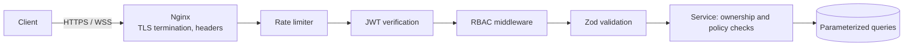

| Threat | Control |
|---|---|
| Credential theft | argon2/bcrypt hashing, login rate limit, generic error messages |
| Token misuse | Short-lived access tokens, signature and expiry checks, secret from env |
| Privilege escalation | RBAC middleware **plus** service-level ownership checks (defense in depth) |
| Injection | ORM with parameter binding; Zod validation with strict schemas |
| XSS | React escaping; no `dangerouslySetInnerHTML`; CSP header |
| CSRF | Bearer tokens in headers (not cookies) or SameSite cookies if cookies are used |
| Data exposure over sockets | Server-side room routing; clients cannot join rooms they are not authorized for |
| Abuse and DoS | Rate limits on REST and per-socket event limits; payload size limits |
| Secrets in repo | `.env.example` only; real secrets via environment or Docker secrets |
| Information leakage | Generic 500 responses; stack traces only in logs |

**Permission matrix**

| Action | Operator | Supervisor | Admin |
|---|---|---|---|
| Create request | yes | yes | yes |
| View own requests | yes | yes | yes |
| View all requests | no | yes | yes |
| Edit priority / assignee | no | yes | yes |
| Cancel | own only | any | any |
| Retry failed | no | yes | yes |
| Comment | on visible requests | yes | yes |
| View stats | no | yes | yes |
| Manage users | no | no | yes |

---

## 13. Frontend architecture

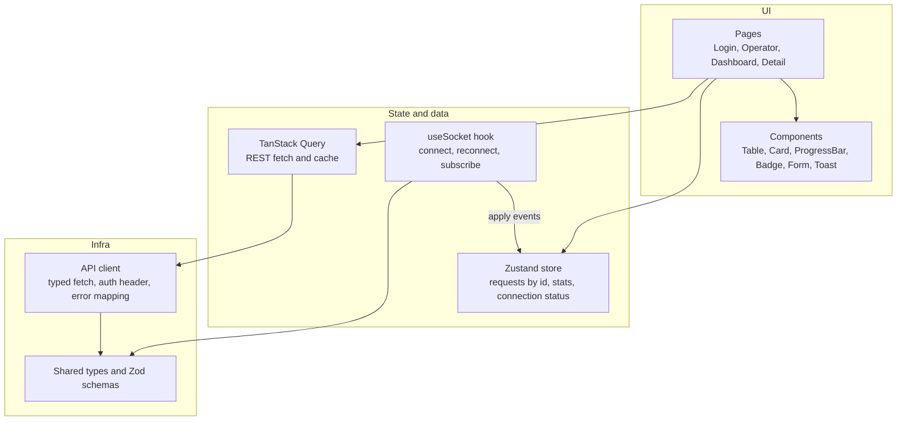

**Data flow rule:** REST loads initial data; socket events patch the store. Components subscribe to slices of the store, so only affected rows re-render when a progress event arrives.

**Handling live updates safely**

- Events carry `eventId` and `version`; the store ignores an event if it is older than the data already held.
- On reconnect, the hook calls `/events?since=...` and replays missed events, or does a full refetch when told the gap is too large.
- Optimistic UI is limited to cancel button state; real status always comes from the server event.

**Responsive layout:** mobile-first. Cards stack on small screens; the dashboard table appears from the `md` breakpoint; filters collapse into a drawer on mobile.

**Form validation:** the same Zod schemas validate on the client (inline errors) and the server (authoritative).

---

## 14. Deployment architecture

### 14.1 Local and demo (Docker Compose)

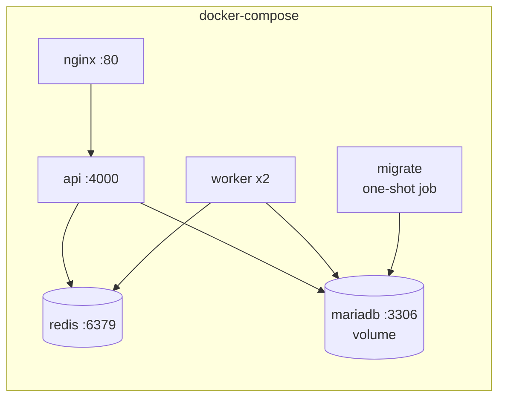

- `docker compose up --build` starts everything; the `migrate` service runs migrations and seeds demo accounts before the API starts (`depends_on` with health checks).
- Worker replicas are set with `deploy.replicas` or `--scale worker=3` to demonstrate scaling.

### 14.2 VPS or cloud deployment (bonus)

- Same containers on a Debian VPS behind Nginx with TLS (Let's Encrypt).
- Persistent volumes for MariaDB and Redis, nightly DB backups.
- Environment variables supplied through an `.env` file outside the repository.
- GitHub Actions: lint, test, build images, push to registry, deploy over SSH.

### 14.3 CI pipeline

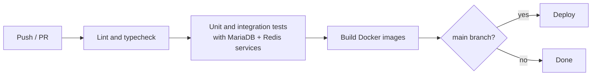

---

## 15. Scalability strategy

| Bottleneck | Approach | Notes |
|---|---|---|
| Job throughput | Raise worker `concurrency`; add worker containers | Linear until DB becomes the limit |
| WebSocket connections | Add API replicas; Socket.IO Redis adapter; sticky sessions at the load balancer | Needed for the Socket.IO handshake |
| DB reads | Indexes, pagination, short-TTL cache for stats; read replicas later | Stats cached in Redis, refreshed on events |
| DB writes | Batch progress persistence at stage boundaries | Avoid per-percent writes |
| Event volume | Throttle and debounce; summaries in list events | Section 8.4 |
| Hot lists | Cursor pagination; archive old completed requests | Future |

**Target numbers for the demo/load script** (documented as goals, not guarantees): 100 simultaneous requests in flight, 500 connected sockets, API p95 under 200 ms during processing.

---

## 16. Observability

- **Structured JSON logs** (pino) with `requestId`, `userId`, `requestRefId`, and `jobId` fields so one request can be traced across API and worker.
- **Log levels:** `info` for state changes, `warn` for retries and conflicts, `error` for unexpected failures.
- **Health endpoints:** `/health/live` (process up) and `/health/ready` (DB and Redis reachable).
- **Metrics endpoint** (`/metrics`, Prometheus format): HTTP latency histogram, active sockets, queue depth by state, jobs completed/failed, job duration, event publish count.
- **Audit trail:** `status_history` doubles as a business-level audit log.
- **Optional dashboard:** Bull Board mounted for supervisors/admins to inspect the queue.

---

## 17. Configuration management

A single typed config module loads environment variables, validates them with Zod at startup, and **fails fast** on missing or invalid values.

| Variable | Example | Purpose |
|---|---|---|
| `NODE_ENV` | `production` | Mode |
| `PORT` | `4000` | API port |
| `DATABASE_URL` | `mysql://user:pass@db:3306/srms` | DB connection |
| `REDIS_URL` | `redis://redis:6379` | Queue and pub/sub |
| `JWT_SECRET` | (random 32+ chars) | Token signing |
| `JWT_EXPIRES_IN` | `15m` | Access token lifetime |
| `WORKER_CONCURRENCY` | `8` | Parallel jobs per worker |
| `JOB_MAX_ATTEMPTS` | `3` | Retries |
| `JOB_FAILURE_RATE` | `0.1` | Simulated failure probability |
| `PROGRESS_EVENT_INTERVAL_MS` | `1000` | Progress throttle |
| `CORS_ORIGIN` | `https://app.example.com` | Allowed origin |
| `RATE_LIMIT_PER_MIN` | `120` | API rate limit |
| `EVENT_RETENTION_HOURS` | `24` | Sync window |

Provide `.env.example` with safe defaults; never commit real secrets.

---

## 18. Testing architecture

| Level | Scope | Tools | Examples |
|---|---|---|---|
| Unit | State machine, validators, policies, stage logic | Vitest/Jest | Illegal transitions rejected; priority mapping |
| Integration (API) | Controllers, services, repositories against a real test DB | Supertest + test containers or Compose services | Create, filter, cancel, conflict, idempotency |
| Integration (queue) | Enqueue and process with a real Redis | BullMQ test mode | Job completes; retry on failure; cancel mid-flight |
| Real-time | Two socket clients; event routing and authorization | socket.io-client | Operator gets only own events; supervisor gets all |
| Concurrency | 50 requests at once | Script/test | At least N `IN_PROGRESS` simultaneously; all reach a final state; no duplicates |
| End-to-end (optional) | Browser flow | Playwright | Operator submits; supervisor sees live progress |

CI runs unit and integration tests on every push; coverage report is attached to the pipeline.

---

## 19. Architecture decision records (ADRs)

Keep each ADR short in `docs/adr/` using: Context, Decision, Consequences.

| ADR | Decision | Reason | Trade-off |
|---|---|---|---|
| 001 | Modular monolith plus separate worker | Small domain; one real boundary (fast vs slow work) | Less isolation than microservices, far less overhead |
| 002 | Socket.IO over raw WebSocket | Rooms, reconnect, auth hook, Redis adapter | Extra library; slightly heavier protocol |
| 003 | BullMQ over in-process queue | Persistence, priorities, retries, multi-worker | Adds Redis dependency |
| 004 | Redis pub/sub as event bus | Decouples worker from gateway; supports many API instances | Pub/sub is fire-and-forget, so reconnect `sync` is needed |
| 005 | DB is source of truth; queue and events are derived | Recovery from any crash | Requires reconcilers |
| 006 | Optimistic locking instead of row locks | Better concurrency; conflicts are rare | Client must handle `409` |
| 007 | Cooperative cancellation | Safe stopping points, no half-written state | Cancel is not instantaneous mid-stage |
| 008 | JWT access tokens | Stateless auth across API replicas and sockets | Revocation needs short expiry or a denylist |
| 009 | Zod shared schemas | One contract for client and server | TypeScript-centric |
| 010 | MariaDB | Relational constraints, familiar tooling | Fulltext search is basic compared with a search engine |

---

## 20. Known limitations and future evolution

**Current limitations**

- Processing is simulated; there is no real external work.
- Redis pub/sub does not guarantee delivery; mitigated by `sync`, not eliminated.
- Single Redis and single DB node; no automatic failover.
- Fulltext search is simple (no typo tolerance or ranking tuning).
- Token revocation relies on short expiry.

**Future evolution**

1. **Transactional outbox** to guarantee that every committed change produces an event.
2. **Split the gateway** into its own service if WebSocket load dominates.
3. **Redis Streams** instead of pub/sub for replayable, acknowledged events.
4. **SLA timers** (delayed jobs) that escalate overdue requests.
5. **Notifications** (email/SMS/push) as another event subscriber.
6. **Read replica and cursor pagination** for large histories.
7. **OpenTelemetry tracing** across API, queue, and worker.
8. **Multi-tenant support** via an `organization_id` on every table and room name.