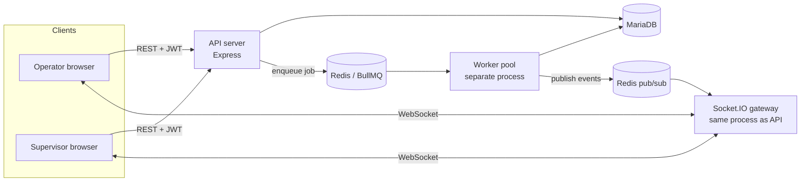
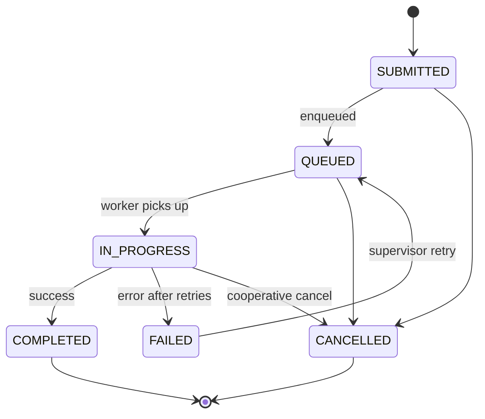
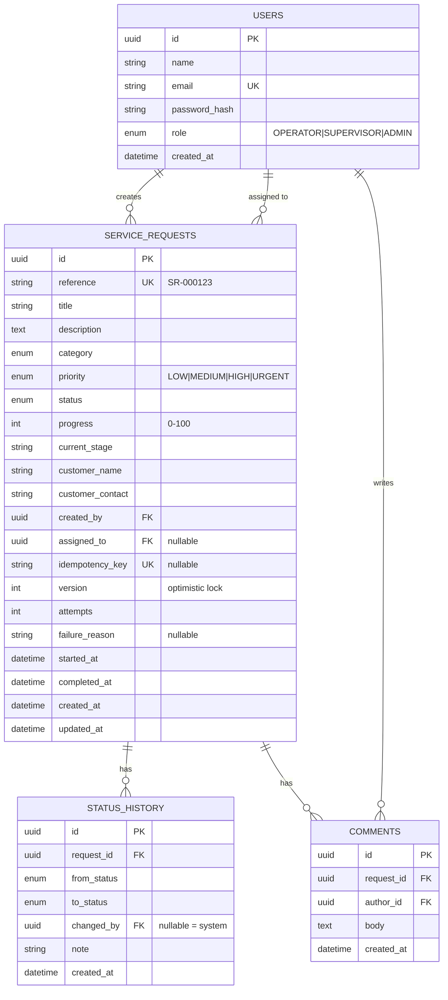

# Real-Time Service Request Management System: Project Plan

A working plan for the assignment: analysis, design, implementation order, and the extra features worth adding beyond the PDF.

---

## 1. Problem in one paragraph

A service organization tracks customer requests manually, so updates are late and progress is invisible. We build a web app where **operators** submit requests, **supervisors** watch them being processed **live**, and a **background worker pool** processes many requests at once without ever blocking the API.

## 2. Users and roles

| Role | Can do |
|---|---|
| **Operator** | Create requests, view own requests, cancel own requests (before completion), comment |
| **Supervisor** | View all requests, live dashboard, assign/reprioritize, cancel/retry any request, see audit history |
| **Admin** (extra) | Manage users and roles, view system metrics |

> Assumption: a request is "processed" by an automated job (simulated long-running work, 5 to 30 seconds with random failures). This is how we demonstrate concurrency honestly without needing real field technicians.

## 3. Scope

**In scope:** auth + roles, request CRUD, status workflow, background processing, WebSocket live updates, search/filter/pagination, audit trail, dashboard, Docker, tests, docs.

**Out of scope:** payments, email/SMS delivery, multi-tenant organizations, native mobile apps, real technician dispatch.

## 4. Functional requirements

### Core (from the PDF)

- **FR1** Create a service request (title, description, category, priority, customer name/contact).
- **FR2** View a paginated list of requests and a detail page.
- **FR3** Update request status (valid transitions only).
- **FR4** Monitor progress (percentage + current stage) in real time.
- **FR5** Receive live updates over WebSocket with no polling.
- **FR6** Cancel requests (including ones currently being processed).
- **FR7** Search and filter by status, priority, category, date range, text, and assignee.

### Added features (recommended)

- **FR8** **Authentication + role-based access control** (JWT, operator / supervisor / admin).
- **FR9** **Status history / audit log** for every change (who, when, from, to).
- **FR10** **Priority-aware queue** (urgent requests are processed first).
- **FR11** **Retry failed requests** (supervisor action) with automatic retry and backoff.
- **FR12** **Assignment** of a request to a supervisor/agent.
- **FR13** **Comments/notes** on a request, pushed live to viewers of that request.
- **FR14** **Dashboard stats** (counts by status, average processing time, throughput) updating live.
- **FR15** **Reconnect recovery**: a client that reconnects fetches events it missed.
- **FR16** **Optimistic locking** to prevent two supervisors overwriting each other.
- **FR17** **Idempotent create** (idempotency key) to prevent duplicate submissions on double-click or retry.
- **FR18** Toast notifications and a connection-status indicator in the UI.

## 5. Non-functional requirements

| Area | Requirement | How we meet it |
|---|---|---|
| Performance | API p95 under 200 ms for reads; long jobs never block the API | Separate worker process, indexed queries, pagination |
| Scalability | Handle 100+ simultaneous jobs and 500+ connected clients | Redis-backed queue, Socket.IO Redis adapter, stateless API |
| Reliability | No lost jobs on restart; no double processing | Persistent queue, DB as source of truth, job locks, retries |
| Security | Only authorized users see/act on data | JWT, RBAC, input validation, rate limiting, helmet, parameterized queries |
| Maintainability | Easy to extend and test | Layered architecture, TypeScript, lint, tests |
| Availability | Survive worker or API restart | Docker restart policies, health checks, graceful shutdown |
| Usability | Clear, fast, accessible UI | Responsive layout, inline validation, empty/loading/error states |
| Observability | Debug problems quickly | Structured logs with request IDs, `/health` and `/metrics` |

## 6. Technology stack and justification

| Layer | Choice | Why |
|---|---|---|
| Language | **TypeScript** (Node.js 20) | One language front and back, shared types, strong ecosystem for WebSockets |
| API | **Express** | Simple, widely known, easy to layer |
| Validation | **Zod** | Runtime validation that also gives TypeScript types |
| Real-time | **Socket.IO** | Rooms, auto-reconnect, fallback transports, Redis adapter for scaling |
| Queue / workers | **BullMQ + Redis** | Persistent jobs, concurrency control, priorities, retries, delayed jobs |
| Database | **MariaDB** (or PostgreSQL) | Relational constraints, transactions, good indexing |
| ORM / migrations | **Prisma** | Typed queries, migration files, easy schema docs |
| Frontend | **React + Vite + TypeScript** | Fast dev loop, component model |
| State | **Zustand** (+ TanStack Query for REST data) | Small, simple, fits live-updating lists |
| Styling | **Tailwind CSS** | Fast responsive layout |
| Testing | **Vitest/Jest + Supertest**, **Playwright** (optional) | Unit, integration, and one end-to-end flow |
| DevOps | **Docker Compose**, **GitHub Actions** | One-command run, CI on every push |

> Alternative if you prefer Python: FastAPI + WebSockets + Celery/RQ + PostgreSQL + React. The architecture below stays the same.

## 7. High-level architecture



**Key idea:** the API only validates, saves, and enqueues, then returns immediately. Workers do the slow part. Workers publish progress events to Redis, and the WebSocket gateway forwards them to the right clients. This keeps the API fast and lets API and workers scale independently.

## 8. Layered backend structure

```
Routes / Controllers  ->  Services (business rules)  ->  Repositories (DB)  ->  MariaDB
        |                        |
   Validation (Zod)        Queue producer / Event emitter
```

- **Controllers**: parse and validate input, call a service, shape the HTTP response.
- **Services**: business rules (status transitions, permissions, cancel logic).
- **Repositories**: all database access, nothing else touches Prisma.
- **Middleware**: auth, RBAC, validation, rate limit, error handler, request ID logger.
- **Config**: one typed config module reading environment variables, failing fast if invalid.

## 9. Request lifecycle (state machine)



Rules: transitions are enforced in one place (a transition map in the service layer). Invalid transitions return `409 Conflict`.

## 10. Database design



**Indexes:** `(status, priority, created_at)`, `(created_by)`, `(assigned_to)`, `reference` unique, fulltext on `title, description`.
**Constraints:** foreign keys with `ON DELETE RESTRICT`, `progress BETWEEN 0 AND 100`, `NOT NULL` on core fields.

## 11. REST API design

Base path `/api/v1`. All responses JSON. Errors use one shape: `{ "error": { "code", "message", "details" } }`.

| Method | Endpoint | Role | Purpose |
|---|---|---|---|
| POST | `/auth/register` | public/admin | Create account |
| POST | `/auth/login` | public | Get JWT |
| GET | `/auth/me` | any | Current user |
| POST | `/requests` | operator+ | Create request (supports `Idempotency-Key` header) |
| GET | `/requests` | any | List with `status, priority, category, q, from, to, assignee, page, limit, sort` |
| GET | `/requests/:id` | owner/supervisor | Detail with history and comments |
| PATCH | `/requests/:id` | supervisor | Update priority, assignee, details (requires `version`) |
| POST | `/requests/:id/cancel` | owner/supervisor | Cancel |
| POST | `/requests/:id/retry` | supervisor | Retry a failed request |
| GET | `/requests/:id/history` | owner/supervisor | Audit trail |
| POST | `/requests/:id/comments` | any with access | Add comment |
| GET | `/stats` | supervisor | Counts, averages, throughput |
| GET | `/events?since=<ts>` | any | Missed events after reconnect |
| GET | `/health` | public | Liveness and readiness |

**HTTP status conventions:** `201` created, `400` validation error, `401` unauthenticated, `403` forbidden, `404` not found, `409` invalid transition or version conflict, `429` rate limited.

## 12. WebSocket design

**Connection:** client connects with its JWT. The server verifies it and puts the socket in rooms:

- `user:<id>`: personal notifications
- `role:supervisor`: supervisor-wide feed
- `request:<id>`: joined when viewing a detail page

**Server to client events**

| Event | Payload | When |
|---|---|---|
| `request:created` | request summary | New request submitted |
| `request:status_changed` | `{ id, from, to, at }` | Any status change |
| `request:progress` | `{ id, progress, stage }` | Worker reports progress (throttled to about 1 per second per request) |
| `request:updated` | request summary | Priority, assignee, or details changed |
| `request:comment_added` | comment | New comment |
| `stats:updated` | stats snapshot | Debounced every 1 to 2 seconds |

**Client to server events**

| Event | Purpose |
|---|---|
| `request:subscribe` / `request:unsubscribe` | Join or leave a detail room |
| `sync` | `{ since }` to fetch missed events after a reconnect |

**Flow:** worker updates DB, then publishes to Redis, then the gateway emits to the correct rooms. Operators only receive events for their own requests; supervisors receive all.

## 13. Concurrency model

- **API process** is non-blocking (Node event loop). Create endpoint does: validate, insert row (status `SUBMITTED`), enqueue job, set `QUEUED`, return `201` in milliseconds.
- **Worker process** runs BullMQ workers with `concurrency = N` (for example 5 to 10), so N requests are processed in parallel. Run more worker containers to scale further.
- **Job stages** (simulated): validate, assign resources, process, finalize. Each stage updates progress and emits an event.
- **Priority:** BullMQ priority maps from request priority so urgent jobs jump the queue.
- **Cancellation:** worker checks a cancel flag between stages (cooperative cancellation).
- **Safety against races:**
  - Status changes use a DB transaction plus `WHERE version = ?` (optimistic locking).
  - Only one worker can hold a job at a time (queue lock), and the worker re-checks status before starting.
  - Jobs are idempotent: re-running a stage never corrupts data.
- **Failure handling:** exponential backoff retries (for example 3 attempts), then `FAILED` with a reason, visible to supervisors.
- **Graceful shutdown:** on SIGTERM, stop accepting jobs, finish or return in-flight jobs to the queue.

## 14. Frontend plan

**Pages**

1. **Login**
2. **Operator view:** "New request" form + my requests list
3. **Supervisor dashboard:** live stat cards, live request table (filters, search, sort), priority and status badges
4. **Request detail:** progress bar, stage timeline, history, comments, actions (cancel, retry, assign)

**State management**

- Zustand store holds requests keyed by ID; WebSocket events patch the store directly (no refetch).
- TanStack Query handles REST fetching, caching, and pagination.
- A `useSocket` hook handles connect, reconnect, and room subscriptions.

**UX details:** responsive layout (cards on mobile, table on desktop), inline form validation (same Zod schemas where possible), connection indicator ("Live" / "Reconnecting"), toasts for important events, skeleton loaders, empty and error states, and accessible components (labels, focus states, keyboard support).

## 15. Security checklist

- Password hashing with bcrypt or argon2
- Short-lived JWT access token (plus refresh token if time allows)
- RBAC enforced in middleware **and** in service layer (ownership checks)
- Zod validation on every input; reject unknown fields
- Rate limiting on auth and create endpoints
- `helmet`, strict CORS, no secrets in git (`.env.example` only)
- Parameterized queries via ORM; output encoded by React
- Socket authentication on connect and room-level authorization

## 16. Project structure

```
service-request-system/
├── README.md
├── docs/
│   ├── 01-system-analysis.md
│   ├── 02-system-design.md      (diagrams, ERD, API, WS, concurrency)
│   └── adr/                     (short decision records)
├── docker-compose.yml
├── .github/workflows/ci.yml
├── backend/
│   ├── src/
│   │   ├── config/
│   │   ├── controllers/
│   │   ├── services/
│   │   ├── repositories/
│   │   ├── middleware/
│   │   ├── validators/
│   │   ├── queue/            (producer, worker, job stages)
│   │   ├── realtime/         (socket gateway, event publisher)
│   │   ├── utils/
│   │   └── server.ts / worker.ts
│   ├── prisma/ (schema, migrations, seed)
│   └── tests/
└── frontend/
    └── src/ (pages, components, hooks, store, api, types)
```

## 17. Implementation roadmap

| Phase | Work | Output |
|---|---|---|
| **0. Setup** | Repo, Docker Compose (MariaDB, Redis), lint/format, config module | Project boots with one command |
| **1. Analysis and design docs** | Write docs 01 and 02, diagrams, ERD, API spec | Documents committed **before** feature code |
| **2. Backend core** | Schema + migrations, auth, request CRUD, validation, error handler | REST API works, tested with Postman/Supertest |
| **3. Queue and workers** | BullMQ, worker process, stages, progress, cancel, retry | Requests processed concurrently |
| **4. Real-time** | Socket gateway, Redis pub/sub bridge, rooms, events | Live updates from worker to browser |
| **5. Frontend** | Auth, form, list, dashboard, detail, socket store | Full flow visible in the UI |
| **6. Extras** | Comments, stats, reconnect sync, idempotency, optimistic lock UI | Polished feature set |
| **7. Quality** | Tests, logging, CI, load demo script, bug fixes | Green pipeline |
| **8. Docs and demo** | README, API and WS docs, screenshots, demo script | Submission ready |

**Priority if time is short:** phases 0 to 5 are required. In phase 6, keep audit history and reconnect sync; drop comments first.

## 18. Git workflow and commit plan

- Branches: `main` plus short feature branches (`feat/auth`, `feat/worker`, ...), merged via PRs even if solo.
- Conventional commits, for example:
  - `docs: add system analysis and design documents`
  - `feat(api): add create service request endpoint with validation`
  - `feat(queue): process requests concurrently with BullMQ workers`
  - `feat(realtime): broadcast status changes over Socket.IO`
  - `test(api): cover invalid status transitions`
- Commit small and often; about 40 to 80 meaningful commits reads well.

## 19. Testing plan

- **Unit:** transition map, validators, permission checks, queue stage logic.
- **Integration:** API endpoints with a test database (auth, create, filter, cancel, conflict cases).
- **Real-time:** connect two socket clients, change status, assert both receive the event.
- **Concurrency:** enqueue 50 requests, assert several are `IN_PROGRESS` simultaneously and all reach a final state.
- **E2E (optional):** Playwright: operator creates a request, supervisor sees it update live.

## 20. Demo script (for presentation)

1. Open two browsers: operator and supervisor.
2. Operator submits several requests, with one urgent.
3. Supervisor dashboard shows them appear instantly and progress bars move in parallel.
4. Cancel one mid-processing; watch it stop.
5. Let one fail, then retry it as supervisor.
6. Stop and restart the API container: clients reconnect and catch up.
7. Show logs, the test run, and the CI badge.

## 21. README checklist

- [ ] Overview and screenshots
- [ ] Architecture diagram and explanation
- [ ] Tech stack and why
- [ ] Assumptions and scope
- [ ] Prerequisites and **one-command setup** (`docker compose up`)
- [ ] Environment variables table
- [ ] Database setup, migrations, seed users
- [ ] Run, build, and test commands
- [ ] API documentation (table plus examples, or OpenAPI link)
- [ ] WebSocket events table
- [ ] Concurrency model explanation
- [ ] Known limitations and future work

## 22. Risks and mitigations

| Risk | Mitigation |
|---|---|
| Over-scoping extras | Build core flow first; extras only after phase 5 works |
| Event flooding the UI | Throttle progress events, debounce stats |
| Race conditions on status | Transactions, optimistic locking, transition map |
| Lost events on disconnect | `sync` endpoint with `since` timestamp |
| Environment setup issues for reviewers | Docker Compose with seeded demo accounts |

## 23. Assumptions (to state in your submission)

1. "Processing" is simulated by background jobs with staged progress and occasional random failure.
2. Single organization; no multi-tenancy.
3. Users are pre-seeded or created by an admin; public self-registration is optional.
4. Requests are never hard-deleted; cancellation is a status.
5. Time is stored in UTC and displayed in the user's local time.

## 24. Next step

Start with **Phase 0 and Phase 1**: create the repo, add Docker Compose, and write `docs/01-system-analysis.md` and `docs/02-system-design.md` using sections 2 to 13 of this plan as the base.