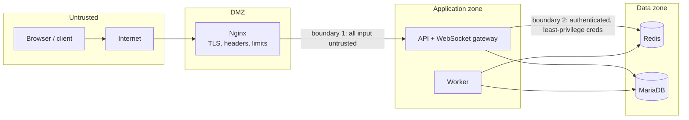
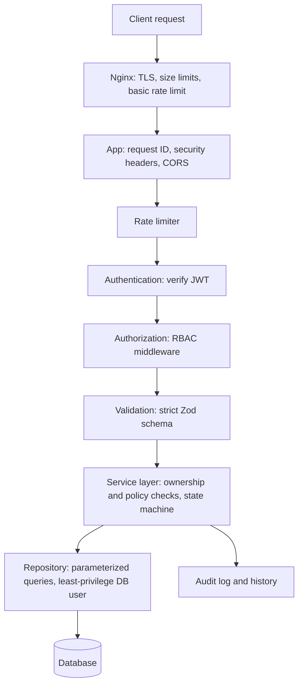
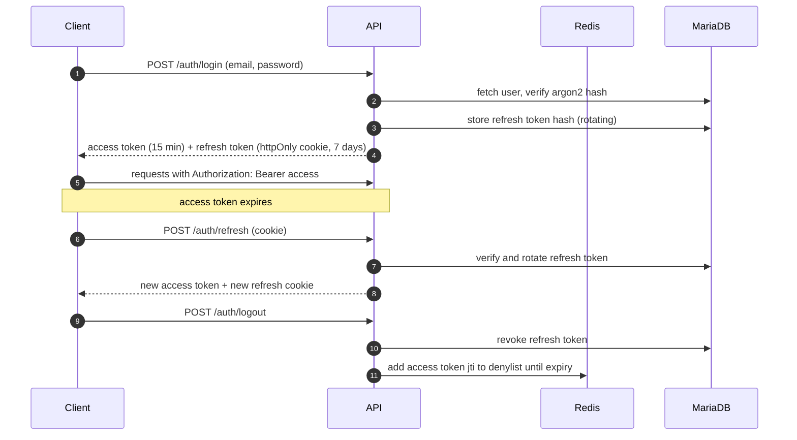
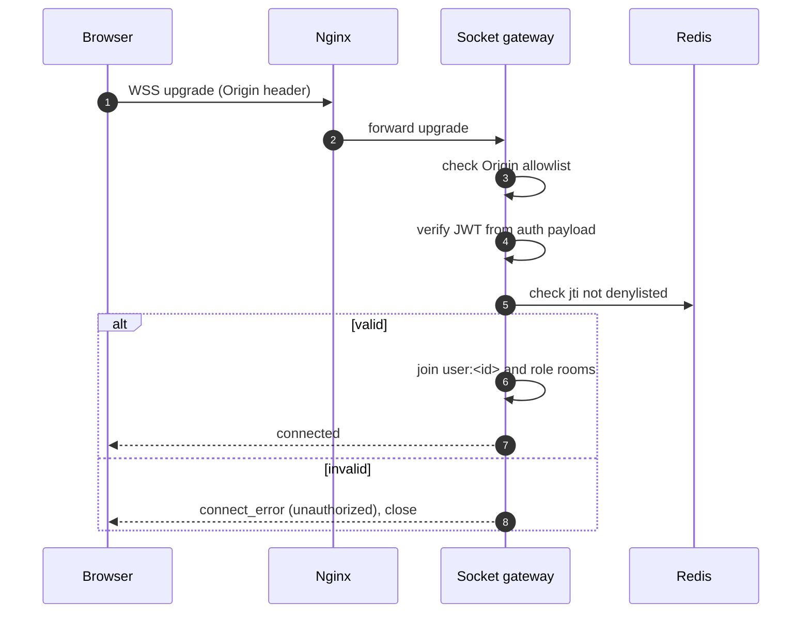
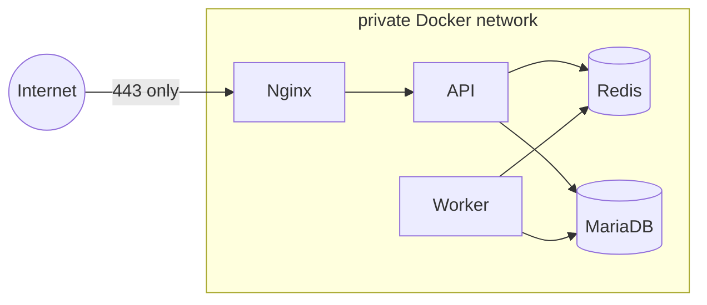

# Security Architecture: Real-Time Service Request Management System

This document expands the security sections of `PLANNING.md` and `ARCHITECTURE.md`. It describes what we protect, who might attack it, and the controls at each layer. It is written for the chosen stack (Node.js/TypeScript, Express, Socket.IO, BullMQ/Redis, MariaDB, React, Docker, Nginx).

**Contents**

1. Security objectives
2. Assets and trust boundaries
3. Threat model (STRIDE)
4. Defense-in-depth overview
5. Authentication
6. Authorization (RBAC and ownership)
7. WebSocket security
8. Input validation and output handling
9. API protection (rate limiting, headers, CORS)
10. Data protection
11. Secrets and configuration security
12. Database and queue security
13. Worker and background job security
14. Frontend security
15. Container, network, and deployment security
16. Logging, auditing, and monitoring
17. Dependency and supply-chain security
18. Incident response basics
19. Security testing plan
20. Security checklist
21. Assumptions, limitations, and future hardening

---

## 1. Security objectives

| Objective | Meaning for this system |
|---|---|
| **Confidentiality** | Operators see only their own requests; supervisors see all; no one outside the system sees anything |
| **Integrity** | Request status changes only through valid, authorized transitions; history cannot be altered |
| **Availability** | The API stays responsive under load or abuse; failures degrade gracefully |
| **Accountability** | Every state change is attributable to a user or to the system |
| **Least privilege** | Users, services, and database accounts get only the access they need |

---

## 2. Assets and trust boundaries

### 2.1 Assets

| Asset | Sensitivity | Notes |
|---|---|---|
| User credentials (password hashes) | High | Never stored or logged in plain text |
| JWT signing secret | Critical | Compromise allows forging any identity |
| Customer data (name, contact) in requests | High (personal data) | Minimize collection, restrict visibility |
| Service request records and history | Medium to high | Business records and audit evidence |
| Queue and event data | Medium | Contains request IDs and status |
| Infrastructure secrets (DB, Redis passwords) | Critical | Provided via environment, never in git |

### 2.2 Trust boundaries



**Boundary 1 (internet to application):** everything is untrusted. Validate, authenticate, rate limit.
**Boundary 2 (application to data):** only application containers can reach Redis and MariaDB; they are not exposed publicly.

---

## 3. Threat model (STRIDE)

| Category | Threat | Example in this system | Mitigation |
|---|---|---|---|
| **Spoofing** | Attacker pretends to be another user | Stolen or forged JWT; credential stuffing | Strong password hashing, login rate limiting, short-lived tokens, HS256/RS256 verified with a strong secret, socket auth on connect |
| **Tampering** | Altering data or status | Operator sends `PATCH` to mark someone else's request complete; modified payloads | RBAC plus ownership checks, state machine enforcement, optimistic locking, append-only history |
| **Repudiation** | User denies an action | "I never cancelled that request" | Audit trail with user ID, timestamp, from/to status, request ID in logs |
| **Information disclosure** | Seeing data not meant for you | Operator joins another request's socket room; verbose errors leak stack traces; IDOR on `/requests/:id` | Server-side room authorization, uniform 404/403 behavior, generic error responses, UUID identifiers plus authorization checks |
| **Denial of service** | Exhausting resources | Flooding create endpoint; opening thousands of sockets; huge payloads; queue flooding | Rate limits, payload size limits, socket connection and event limits, queue per-user limits, resource limits on containers |
| **Elevation of privilege** | Gaining higher role | Self-registering as supervisor; mass assignment of `role` field | Role assignment only by admin, strict Zod schemas that reject unknown fields, role read from DB/token never from request body |

### Abuse cases to design against

1. A malicious operator guesses request IDs to read others' requests (IDOR).
2. A user replays a stolen token after logout.
3. A client sends a thousand `request:subscribe` events to scrape data.
4. A user submits a title with `<script>` to attack supervisors (stored XSS).
5. Script floods `POST /requests` to fill the queue and starve urgent work.
6. An attacker brute-forces the login endpoint.
7. Someone sends a malformed JSON body or oversized payload to crash the server.

---

## 4. Defense-in-depth overview



No single layer is trusted alone. For example, a request to cancel someone else's request is stopped by the route-level role check, again by the service-level ownership check, and finally recorded if it ever succeeds.

---

## 5. Authentication

### 5.1 Password handling

| Control | Decision |
|---|---|
| Hashing | **argon2id** (preferred) or bcrypt with cost 12 or higher; unique salt per password |
| Policy | Minimum 10 characters; reject very common passwords; no composition gimmicks; maximum 128 characters to prevent hashing DoS |
| Storage | Only the hash is stored; hashes never returned by any API or logged |
| Comparison | Library's constant-time verify function |
| Error messages | Same message for wrong email or wrong password: "Invalid email or password" |
| Timing | Run a dummy hash when the email does not exist to reduce user-enumeration timing differences |

### 5.2 Login protection

- **Rate limit:** for example 5 attempts per minute per IP and per email, using Redis counters.
- **Progressive delay or temporary lockout** after repeated failures (for example 15 minutes after 10 failures), with the lockout visible in logs.
- **No account enumeration:** registration and password reset responses do not reveal whether an email exists.
- Failed and successful logins are logged (without passwords).

### 5.3 Token strategy



| Item | Decision |
|---|---|
| Access token | JWT, 15 minutes, signed (HS256 with a 32+ byte secret, or RS256 if keys are used) |
| Claims | `sub` (user ID), `role`, `jti`, `iat`, `exp`; **no** personal data |
| Refresh token | Random opaque value (not JWT), stored hashed in DB, **rotated on each use**, 7-day expiry, bound to user and optionally to user agent |
| Refresh transport | `HttpOnly; Secure; SameSite=Strict` cookie, path limited to `/api/v1/auth` |
| Access token transport | `Authorization: Bearer` header; kept in memory in the SPA, **not** in localStorage |
| Reuse detection | If a rotated refresh token is presented again, revoke the whole token family and force re-login |
| Logout | Revoke refresh token; denylist the access token `jti` in Redis until it expires |
| Algorithm pinning | Verify with an explicit algorithm allowlist; reject `alg: none` |

> **Simplified option for the assignment:** if time is limited, use a single access token (30 to 60 minutes) plus logout via denylist. Document the refresh-token design as the production approach.

### 5.4 Account lifecycle

- New users are created by an admin, or via self-registration limited to the **Operator** role.
- Deactivated users (`active = false`) are rejected at login, and existing tokens stop working because every request loads the user's `active` and `role` status (cached briefly in Redis).
- Role changes take effect within the cache TTL (for example 60 seconds), and the user's sockets are disconnected on role change so they rejoin with the correct rooms.

---

## 6. Authorization (RBAC and ownership)

### 6.1 Model

Two checks apply to every protected action:

1. **Role check (coarse):** is this role allowed to call this operation at all? Done in route middleware.
2. **Policy check (fine):** is this user allowed to act on *this* resource? Done in the service layer.

```ts
// Route level
router.post('/requests/:id/retry', authenticate, requireRole('SUPERVISOR', 'ADMIN'), controller.retry);

// Service level
function canViewRequest(user: User, req: ServiceRequest): boolean {
  return user.role !== 'OPERATOR' || req.createdBy === user.id || req.assignedTo === user.id;
}
```

### 6.2 Permission matrix

| Action | Operator | Supervisor | Admin |
|---|---|---|---|
| Create request | yes | yes | yes |
| View own requests | yes | yes | yes |
| View any request | no | yes | yes |
| Edit priority / assignee | no | yes | yes |
| Cancel request | own only | any | any |
| Retry failed request | no | yes | yes |
| Add comment | on requests they can view | yes | yes |
| View dashboard stats | no | yes | yes |
| View queue dashboard (Bull Board) | no | read-only | yes |
| Create / deactivate users, change roles | no | no | yes |

### 6.3 Rules that prevent common flaws

| Flaw | Prevention |
|---|---|
| **IDOR** (guessing IDs) | UUIDs for IDs, but **authorization is always checked**; unauthorized access returns `404` (not `403`) for operators to avoid confirming existence |
| **Mass assignment** | Zod schemas with `.strict()`; DTOs list allowed fields explicitly; `role`, `createdBy`, `status`, `version` can never be set via a create body |
| **Privilege escalation** | Role is read from the verified token and re-checked against the DB/cache; only admin endpoints change roles |
| **State abuse** | Status changes go only through the state machine; clients cannot send an arbitrary `status` field |
| **Filter leakage** | List queries for operators always append `created_by = :userId` server-side; query params cannot widen scope |
| **Search leakage** | Full-text search is run inside the same scoped query, never against unscoped data |

### 6.4 Policy testing

Every route has an authorization test matrix: for each role and each endpoint, assert allowed or forbidden. This table doubles as living documentation.

---

## 7. WebSocket security

### 7.1 Connection handshake



| Control | Detail |
|---|---|
| **Encrypted transport** | WSS only in production; plain WS rejected |
| **Origin check** | Allowlist of exact origins (`CORS_ORIGIN`), preventing cross-site WebSocket hijacking |
| **Authentication** | JWT sent in the Socket.IO `auth` field (not in the URL query string, to avoid token leakage in logs) |
| **Token expiry** | Server disconnects sockets when the token expires; client refreshes and reconnects |
| **Revocation** | On logout, role change, or deactivation, server disconnects that user's sockets (`io.in('user:<id>').disconnectSockets()`) |

### 7.2 Room and event authorization

- Clients **cannot choose their own rooms** except through `request:subscribe`, which runs the same `canViewRequest` policy used by REST.
- The server decides audience for every event (see routing rules in `ARCHITECTURE.md` section 8). Clients never publish events to other clients.
- Client-to-server events are limited to a small allowlist (`request:subscribe`, `request:unsubscribe`, `sync`). Unknown events are ignored and counted.
- Every incoming event payload is validated with Zod.

### 7.3 Abuse and resource limits

| Limit | Example value |
|---|---|
| Max concurrent sockets per user | 5 |
| Max subscribed request rooms per socket | 20 |
| Client events per second per socket | 10 |
| Max message size (`maxHttpBufferSize`) | 10 KB |
| Ping timeout / interval | Defaults tuned to drop dead connections within about 30 seconds |
| `sync` requests | 1 per 5 seconds per socket, with a bounded event window |

Offenders are disconnected and logged.

### 7.4 Data minimization in events

- List-level events carry summaries, not full records.
- Customer contact details are excluded from events unless the audience is authorized for them.
- Events never carry secrets, tokens, or internal error stack traces; failure events carry a safe `reason` code.

---

## 8. Input validation and output handling

### 8.1 Validation strategy

| Rule | Implementation |
|---|---|
| Validate **everything** that crosses a boundary | Body, query, params, headers, socket payloads, job payloads |
| Allowlist, not blocklist | Zod schemas define exactly the permitted shape; `.strict()` rejects extras |
| Type and range | Enums for category/priority/status; `limit` max 100; dates parsed and bounded |
| Length limits | `title` 3 to 120, `description` up to 4000, `customerName` up to 100, comment up to 2000 |
| Normalization | Trim whitespace, normalize Unicode (NFC), lowercase emails |
| Format checks | Email format, phone number pattern, UUID format on IDs |
| Fail closed | On validation failure return `400` with field-level messages that do not echo dangerous content back unescaped |

### 8.2 Injection prevention

| Attack | Defense |
|---|---|
| **SQL injection** | ORM with parameter binding; no string-concatenated SQL; sort columns from a whitelist; fulltext query terms passed as bound parameters |
| **NoSQL / Redis command injection** | Redis keys built from validated IDs only; no user-supplied command names |
| **Command injection** | No shell execution with user input |
| **Header injection** | No user input in response headers; framework sanitization |
| **Log injection** | Structured JSON logging so newlines or control characters in user input cannot forge log lines |

### 8.3 Output handling (XSS)

- React escapes output by default. **Never** use `dangerouslySetInnerHTML` for user content.
- Free-text fields are stored as plain text and rendered as text. If rich text is ever required, sanitize with an allowlist library (for example DOMPurify) on render.
- API returns `Content-Type: application/json` with `X-Content-Type-Options: nosniff`.
- A strict Content Security Policy provides a second layer (see 9.2).

### 8.4 File uploads

Not in scope. If attachments are added later: size limit, MIME and magic-byte check, random file names, storage outside the web root or in object storage, malware scan, and no inline rendering of untrusted types.

---

## 9. API protection

### 9.1 Rate limiting and abuse control

| Scope | Limit (example) | Store |
|---|---|---|
| Global per IP | 300 requests / minute | Redis |
| `POST /auth/login` | 5 / minute per IP and per email | Redis |
| `POST /auth/register`, refresh | 10 / minute per IP | Redis |
| `POST /requests` | 30 / minute per user | Redis |
| Search/list endpoints | 120 / minute per user | Redis |
| Queue protection | Max 50 open (`SUBMITTED`/`QUEUED`/`IN_PROGRESS`) requests per operator | DB count check |

Exceeding returns `429` with a `Retry-After` header. Nginx adds a coarse first-line limit (`limit_req`).

### 9.2 Security headers and CORS

| Header | Value |
|---|---|
| `Strict-Transport-Security` | `max-age=31536000; includeSubDomains` |
| `Content-Security-Policy` | `default-src 'self'; script-src 'self'; style-src 'self'; connect-src 'self' wss://<host>; img-src 'self' data:; frame-ancestors 'none'; base-uri 'self'; form-action 'self'` |
| `X-Content-Type-Options` | `nosniff` |
| `X-Frame-Options` | `DENY` (also covered by `frame-ancestors`) |
| `Referrer-Policy` | `no-referrer` or `strict-origin-when-cross-origin` |
| `Permissions-Policy` | Disable unused features (camera, microphone, geolocation) |
| `Cache-Control` | `no-store` on authenticated API responses |

- **CORS:** exact origin allowlist from configuration, `credentials: true` only if cookies are used, restricted methods and headers; no wildcard origins in production.
- `helmet` middleware applies most headers; Nginx adds HSTS and TLS settings.
- Disable `X-Powered-By`.

### 9.3 Request hardening

- JSON body limit (for example 100 KB), URL and header size limits, request timeout (for example 30 seconds).
- Reject unsupported content types with `415`.
- Parameter pollution handled by strict schemas.
- Idempotency keys validated for format and scoped per user so one user cannot probe another's keys.

### 9.4 Error handling

- Uniform error shape; unexpected errors return `INTERNAL_ERROR` with only the request ID.
- Stack traces, SQL errors, and file paths are logged server-side only.
- Authentication failures never specify *which* part failed.
- `404` for resources a user may not see.

---

## 10. Data protection

### 10.1 Data classification

| Data | Class | Handling |
|---|---|---|
| Password hash, refresh token hash | Secret | Hash only, never logged, never exposed |
| Customer name and contact | Personal data | Visible to owner, assigned user, supervisors; masked in logs |
| Request content | Internal | Role-scoped access |
| Status history, audit events | Internal / integrity-critical | Append-only |
| Metrics and counters | Low | No personal data |

### 10.2 In transit

- TLS 1.2+ (prefer 1.3) at Nginx for HTTPS and WSS; strong cipher suites; HTTP redirects to HTTPS; HSTS.
- Internal traffic stays on a private Docker network. In a multi-host deployment, enable TLS for Redis and MariaDB connections as well.

### 10.3 At rest

- Database volume on encrypted disk (for example LUKS or cloud-provider encryption).
- Backups encrypted and stored separately; restore tested.
- Redis persistence file protected by file permissions; Redis holds job IDs and event envelopes only, not passwords or full customer details.
- Optional: field-level encryption for `customer_contact` using an application key kept outside the database.

### 10.3.1 Minimization and retention

- Collect only what the process needs; `customer_contact` is optional.
- `domain_events` pruned after 24 hours; completed BullMQ jobs removed after about 1 hour.
- Define a retention period for completed requests (for example archive after 12 months) and describe how personal data can be removed or anonymized on request.

### 10.4 Logs and privacy

- Never log passwords, tokens, refresh cookies, or full customer contact details.
- Mask where needed (`+88017******12`).
- Redact `authorization` and `cookie` headers in request logs.

---

## 11. Secrets and configuration security

| Secret | Where it lives | Rotation |
|---|---|---|
| `JWT_SECRET` (or private key) | Environment variable / Docker secret | Rotate periodically; support two active keys (`kid`) during rotation |
| DB password | Environment / Docker secret | Rotate with deployment |
| Redis password | Environment / Docker secret | Rotate with deployment |
| Seed admin password | Provided at first run via env; forced change on first login | One-time |

Rules:

1. **No secrets in git.** Only `.env.example` with placeholders is committed; `.env` is in `.gitignore`.
2. Config is validated at startup; the app refuses to boot with a missing or weak secret (for example `JWT_SECRET` shorter than 32 characters).
3. No default passwords in production configuration; demo credentials exist only in the dev seed and are documented as such.
4. CI uses repository secrets, never printed in logs.
5. Run a secret scanner (for example gitleaks) in CI and as a pre-commit hook.
6. If a secret is ever committed, treat it as compromised: rotate it, don't just delete the commit.

---

## 12. Database and queue security

### 12.1 MariaDB

| Control | Detail |
|---|---|
| Least-privilege accounts | App user: `SELECT, INSERT, UPDATE` on app tables only (no `DROP`, `ALTER`, `GRANT`). A separate migration user has schema privileges and is used only by the one-shot migrate job |
| Network | Not published to the host or internet; reachable only on the Docker network |
| Authentication | Strong password; no anonymous or empty-password users; remote root disabled |
| Integrity | Foreign keys, `NOT NULL`, enum and `CHECK` constraints; `status_history` has no update/delete in application code |
| Immutable audit | Optionally revoke `UPDATE`/`DELETE` on `status_history` for the app user |
| Backups | Encrypted, scheduled, restore tested |
| Connection | Parameterized statements only; connection pool limits to avoid exhaustion |

### 12.2 Redis

| Control | Detail |
|---|---|
| Authentication | `requirepass` (or ACL users) enabled |
| Network | Internal Docker network only; port not published |
| Dangerous commands | Disable or rename `FLUSHALL`, `CONFIG`, `DEBUG`, `KEYS` for app users via ACL |
| Persistence | AOF enabled so jobs survive restarts |
| Key hygiene | Namespaced keys (`srms:queue:*`, `srms:ratelimit:*`, `srms:denylist:*`); TTLs on rate-limit and denylist keys |
| Memory | `maxmemory` with an eviction policy that does **not** evict queue keys (use `noeviction` for the queue instance, or separate instances for cache and queue) |

---

## 13. Worker and background job security

| Concern | Control |
|---|---|
| **Job payload tampering** | Jobs contain only the `requestId`; the worker loads current data and permissions from the DB and never trusts payload content |
| **Authorization drift** | State transitions in workers still pass through the state machine, so a worker cannot move a request to an illegal state |
| **Double execution** | Queue lock plus compare-and-set status update (see `ARCHITECTURE.md` 9.3) |
| **Resource exhaustion** | Concurrency cap, job timeout, per-user open request limit, max retry attempts with backoff |
| **Poison jobs** | After max attempts the request becomes `FAILED` and stops retrying automatically |
| **Least privilege** | Worker uses its own DB credentials limited to the tables it needs |
| **System actor identity** | Worker changes are recorded with `changed_by = NULL` and note `system`, clearly distinguishable from human actions |
| **Queue dashboard** | Bull Board mounted behind authentication, restricted to admin (read-only for supervisors), served on an internal path |

---

## 14. Frontend security

| Concern | Control |
|---|---|
| Token storage | Access token in memory only; refresh token in `HttpOnly` cookie. No tokens in `localStorage` or `sessionStorage` |
| XSS | React escaping; no `dangerouslySetInnerHTML`; strict CSP; no inline scripts |
| CSRF | Refresh endpoint uses `SameSite=Strict` cookie plus a custom header requirement (`X-Requested-With`) or CSRF token; all other calls use the bearer header, which is not auto-attached by browsers |
| Clickjacking | `frame-ancestors 'none'` |
| Route protection | Client-side route guards for UX only; **real enforcement is always on the server** |
| Role-based UI | Hide actions the user cannot perform, while the API still rejects them |
| Sensitive data in UI | No tokens or secrets in the DOM, URL, or console logs |
| Dependencies | `npm audit` in CI, lockfile committed, minimal third-party packages |
| Build | Production build with source maps not publicly exposed (or uploaded only to an error-tracking service) |
| Session handling | On `401`, attempt a single refresh; on failure clear state and redirect to login; auto-logout on token revocation events |

---

## 15. Container, network, and deployment security

### 15.1 Containers

- Minimal base images (for example `node:20-alpine`), pinned to a version or digest.
- **Multi-stage builds**; final image contains only built output and production dependencies.
- Run as a **non-root user**; read-only root filesystem where possible; `no-new-privileges`; drop unneeded Linux capabilities.
- No secrets baked into images; no `.env` copied into the build context (`.dockerignore`).
- CPU and memory limits per container to contain DoS impact.
- Image vulnerability scan in CI (for example Trivy).
- Health checks defined so unhealthy containers restart.

### 15.2 Network



- Only Nginx publishes ports (80 redirecting to 443, and 443). API, worker, Redis, and MariaDB publish nothing.
- On a VPS: firewall (for example `ufw`) allows only 22 (restricted), 80, 443; SSH key-only login, password login disabled, `fail2ban` enabled, non-root deploy user.

### 15.3 Nginx hardening

- TLS 1.2/1.3 only, modern ciphers, OCSP stapling, certificates from Let's Encrypt with auto-renewal.
- `client_max_body_size` small; timeouts configured; `limit_req` and `limit_conn` zones.
- WebSocket upgrade proxying with explicit `Upgrade` and `Connection` headers.
- Hide server version (`server_tokens off`).
- Forward the real client IP carefully (`X-Forwarded-For`), and configure Express `trust proxy` correctly so rate limits key on the real IP and spoofed headers are not trusted from outside.

### 15.4 CI/CD

- Branch protection on `main` with required status checks.
- Pipeline stages: lint, tests, dependency audit, secret scan, image scan, build, deploy.
- Deploy credentials stored as CI secrets with minimal scope; deploy over SSH with a dedicated key.

---

## 16. Logging, auditing, and monitoring

### 16.1 Two kinds of records

| Record | Purpose | Storage |
|---|---|---|
| **Business audit** | Who changed what in a request, and when | `status_history`, `comments` (DB, append-only) |
| **Security / operational log** | Auth events, denials, errors, anomalies | Structured JSON logs (pino), shipped to a log store if available |

### 16.2 Security events to log

- Login success and failure (with user ID or email hash, IP, user agent)
- Token refresh, refresh reuse detection, logout
- Authorization denials (`403`, and `404`s caused by policy)
- Role changes, user creation and deactivation
- Rate-limit hits and socket disconnections for abuse
- Validation failures above a threshold (possible probing)
- State transition conflicts and invalid transition attempts
- Admin and queue-dashboard access

Each entry includes `timestamp`, `requestId`, `userId`, `ip`, `event`, and `outcome`.

### 16.3 Alert ideas (optional)

| Signal | Possible meaning |
|---|---|
| Many failed logins for one account or IP | Brute force or credential stuffing |
| Refresh token reuse detected | Token theft |
| Spike of `403`/`404` from one user | IDOR probing |
| Socket connection surge | Resource exhaustion attempt |
| Queue depth growing with workers idle | Worker failure or poisoning |

### 16.4 Log protection

- Logs contain no secrets or full personal data.
- Access to logs restricted; retention defined (for example 30 to 90 days).
- Clock synchronized (NTP) so audit timestamps are trustworthy; store timestamps in UTC.

---

## 17. Dependency and supply-chain security

- Commit lockfiles; use `npm ci` in CI and Docker builds.
- Enable Dependabot or Renovate for updates; review security advisories.
- `npm audit --omit=dev` (or equivalent) fails the build on high/critical issues.
- Prefer well-maintained packages; avoid abandoned ones; keep the dependency tree small.
- Verify the origin of Docker base images; pin versions.
- Generate an SBOM (optional) for the final images.

---

## 18. Incident response basics

| Step | Action |
|---|---|
| 1. Detect | Alerts, logs, user reports |
| 2. Contain | Disable affected accounts, revoke refresh tokens, rotate secrets, block IPs, scale down exposed components |
| 3. Eradicate | Patch vulnerability, remove malicious data, rebuild images |
| 4. Recover | Restore from backup if needed, re-enable service, monitor closely |
| 5. Review | Write a short post-incident note: timeline, cause, fix, prevention |

**Emergency levers built into the design**

- Global "revoke all sessions" by changing the JWT secret or `kid` and clearing refresh tokens.
- Per-user disconnect and deactivate through the admin API.
- Feature flags or config switches to pause worker processing or disable registration.

---

## 19. Security testing plan

| Test type | What it checks | Tools / method |
|---|---|---|
| **Authorization matrix tests** | Every endpoint x every role returns the expected result | Supertest, table-driven tests |
| **IDOR tests** | Operator A cannot read, cancel, or subscribe to Operator B's request | Integration tests (REST and socket) |
| **Mass assignment tests** | Extra fields (`role`, `status`, `createdBy`) are rejected | Integration tests |
| **Validation tests** | Oversized, malformed, wrong-type, and boundary inputs | Unit and integration tests |
| **Auth tests** | Expired, tampered, wrong-algorithm, and revoked tokens fail; refresh reuse detected | Integration tests |
| **Rate limit tests** | Login and create endpoints return `429` after the limit | Integration tests |
| **Socket security tests** | Unauthenticated connect fails; wrong origin rejected; unauthorized subscribe denied; event flood disconnects | socket.io-client tests |
| **XSS tests** | `<script>` payloads render as text in lists, details, comments | Playwright or component tests |
| **Dependency / image scan** | Known vulnerabilities | `npm audit`, Trivy |
| **Secret scan** | Leaked credentials | gitleaks |
| **Basic dynamic scan** (optional) | Common web flaws and header misconfiguration | OWASP ZAP baseline against the running stack |

Map results to the **OWASP Top 10 (2021)** in the README to show coverage:

| OWASP category | Where addressed |
|---|---|
| A01 Broken Access Control | Sections 6, 7.2 |
| A02 Cryptographic Failures | Sections 5.1, 10 |
| A03 Injection | Section 8 |
| A04 Insecure Design | Sections 3, 4, state machine, limits |
| A05 Security Misconfiguration | Sections 9.2, 11, 15 |
| A06 Vulnerable Components | Section 17 |
| A07 Identification and Authentication Failures | Section 5 |
| A08 Software and Data Integrity Failures | Sections 12, 13, 15.4, 17 |
| A09 Logging and Monitoring Failures | Section 16 |
| A10 SSRF | No server-side fetching of user-supplied URLs; if added later, use an allowlist and block internal ranges |

---

## 20. Security checklist

**Authentication and sessions**
- [ ] argon2id/bcrypt hashing, password policy enforced
- [ ] Login rate limiting and lockout
- [ ] Short-lived access tokens; refresh rotation (or documented simplification)
- [ ] Algorithm pinned; secret at least 32 characters
- [ ] Logout revokes tokens; deactivated users blocked

**Authorization**
- [ ] Route-level RBAC on every endpoint
- [ ] Ownership/policy checks in services
- [ ] Operators' list queries scoped server-side
- [ ] State machine is the only way to change status
- [ ] Strict schemas block mass assignment

**Real-time**
- [ ] WSS only, Origin allowlist
- [ ] JWT auth on connect; disconnect on revoke or expiry
- [ ] Room joins authorized by policy
- [ ] Client event allowlist, validation, and rate limits
- [ ] Events minimized and audience-filtered

**Data and secrets**
- [ ] TLS everywhere externally; DB volume encrypted
- [ ] No secrets in git; `.env.example` only; secret scan in CI
- [ ] Sensitive fields never logged
- [ ] Retention and cleanup jobs defined

**Infrastructure**
- [ ] Only Nginx exposed; DB and Redis internal
- [ ] Non-root containers, resource limits, minimal images
- [ ] Least-privilege DB users; Redis auth and ACL
- [ ] Firewall and SSH hardening on the VPS

**Process**
- [ ] Dependency audit and image scan in CI
- [ ] Security tests for the abuse cases in section 3
- [ ] Security events logged and reviewable
- [ ] Incident steps documented

---

## 21. Assumptions, limitations, and future hardening

**Assumptions**

- A single organization; users are trusted employees but not trusted with data beyond their role.
- The deployment sits behind Nginx with TLS; browsers are modern.
- Customer data is limited to name and optional contact details.

**Known limitations**

- Access-token revocation relies on a Redis denylist and short expiry; a Redis outage weakens immediate revocation (mitigated by the 15-minute lifetime).
- No multi-factor authentication in the base scope.
- Redis pub/sub events are not signed; they are trusted because Redis is inside the private network.
- Brute-force protection is IP/email based and does not include CAPTCHA.
- No dedicated WAF or intrusion detection in the base setup.

**Future hardening**

1. Multi-factor authentication (TOTP) for supervisors and admins.
2. Asymmetric JWT signing (RS256/EdDSA) with key rotation through `kid` and a JWKS endpoint.
3. Field-level encryption for personal data with managed keys (KMS).
4. Signed events or Redis ACL separation between publishers and subscribers.
5. Transactional outbox plus tamper-evident audit log (hash chaining).
6. WAF, centralized logging with alerting (for example Loki/Grafana or ELK), and OpenTelemetry tracing.
7. Automated DAST and periodic penetration testing.
8. Single sign-on (OIDC) for organizations that need it.